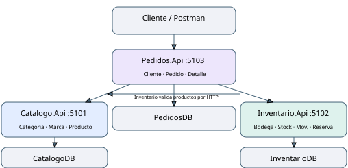

# Diseño de Arquitecturas Distribuidas

Instituto Superior Tecnológico Cordillera — Carrera de Desarrollo de Software

Aplicaciones Distribuidas — Unidad 1 — Práctica 1 — Código AD01

Estudiante: Pablo Matias Roman Ruiz. Nivel/paralelo: 4.º B. Nombre corto: Matias Roman.

Fecha de preparación: 11 de noviembre de 2026.

## 1. Problema y objetivo

Una comercializadora tecnológica necesita administrar productos, varias bodegas y órdenes de compra. Si todas las funciones dependen de las mismas tablas, un cambio en inventario puede afectar el catálogo o los pedidos. Se propone separar responsabilidades en tres microservicios REST con ASP.NET Core Web API y SQL Server, como pide el enunciado AD01.

El objetivo es implementar operaciones sobre datos, validar entradas, conservar relaciones correctas y demostrar su funcionamiento con una colección Postman reproducible. La solución aplica orientación a servicios mediante tres aplicaciones concretas que se ejecutan como procesos independientes [1,3].

## 2. Arquitectura implementada

Catalogo.Api es propietario de CatalogoDB; Inventario.Api de InventarioDB; Pedidos.Api de PedidosDB. Las soluciones no comparten proyectos, clases de entidad ni conexiones de base. Cada una incluye modelos, DTO, controladores, DbContext y migraciones propias [2,3].

La comunicación entre servicios usa HttpClient con JSON y tiempo máximo de cinco segundos. Inventario consulta Catálogo para validar productos. Pedidos consulta Catálogo para estado y precio, y consulta Inventario para disponibilidad. Las consultas locales siguen disponibles si otra API está detenida. Se devuelve 503 cuando una operación no puede completar una validación remota.

No se implementa un API Gateway ni autenticación, pagos, facturación o una plataforma de despliegue: el enunciado de esta práctica se centra en diseño de dominios, datos, REST y pruebas locales. El acceso de demostración es HTTP en localhost y Swagger se habilita en Development.

## 3. Tecnologías y decisiones

- ASP.NET Core 10, C# y controladores con ApiController: rutas explícitas y validación automática de DTO [1].
- Entity Framework Core 10.0.15 con proveedor SQL Server: mapeo de entidades, consultas LINQ y migraciones [2].
- Swashbuckle 10.3.1: interfaz Swagger para explorar cada API.
- SQL Server local con autenticación integrada de Windows. Las credenciales no se escriben en el código.
- DTO de entrada separados de entidades: el cliente no puede asignar IDs, stock, fechas, total o precios históricos arbitrarios.
- Controladores sencillos para maestros y servicios de aplicación para reglas de stock y validación de pedidos. No se agrega una capa de repositorios que únicamente repita las operaciones de DbContext.
- Postman Collection v2.1 y ejecución automática con Newman 6.2.3, con datos de laboratorio ficticios [5].

## 4. Modelo de datos

Todos los identificadores primarios son int IDENTITY. Las cadenas se almacenan en nvarchar con límites explícitos. Fechas en UTC se mapean a datetime2.

### 4.1. CatalogoDB

| Tabla | Campos y tipos principales |
|---|---|
| Categoria | IdCategoria int PK; Nombre nvarchar(100); Descripcion nvarchar(300) |
| Marca | IdMarca int PK; Nombre nvarchar(100); PaisOrigen nvarchar(80) |
| Producto | IdProducto int PK; IdCategoria int FK; IdMarca int FK; Nombre nvarchar(150); SKU nvarchar(40); Precio decimal(10,2); Estado bit |

Nombre de categoría y marca, y SKU de producto tienen índices únicos. Precio debe ser mayor que cero y admite dos decimales. Estado usa true para activo y false para inactivo. Las FK de Producto a Categoria y Marca son físicas y restringen el borrado de maestros relacionados.

DELETE de Producto realiza una baja lógica. La fila permanece para no invalidar referencias e historial de otros dominios.

### 4.2. InventarioDB

| Tabla | Campos y tipos principales |
|---|---|
| Bodega | IdBodega int PK; Nombre nvarchar(100); Ciudad nvarchar(80); Direccion nvarchar(250) |
| Existencia | IdExistencia int PK; IdProducto int lógico; IdBodega int FK; Stock int |
| MovimientoInventario | IdMovimiento int PK; IdProducto int lógico; IdBodega int FK; Tipo nvarchar(10); Cantidad int; Fecha datetime2 |
| ReservaStock | IdReserva int PK; IdProducto int lógico; IdBodega int FK; Cantidad int; Estado nvarchar(15) |

Las tres tablas operativas tienen FK físicas a Bodega. IdProducto se verifica por HTTP contra Catálogo y no se transforma en una FK SQL entre bases. Existe un índice único sobre producto/bodega en Existencia. Se restringe Stock >= 0, Cantidad > 0, Tipo en Entrada/Salida y Estado de reserva en Activa/Cancelada/Consumida.

### 4.3. PedidosDB

| Tabla | Campos y tipos principales |
|---|---|
| Cliente | IdCliente int PK; Nombres nvarchar(150); Cedula nvarchar(10); Correo nvarchar(150) |
| Pedido | IdPedido int PK; IdCliente int FK; Fecha datetime2; Total decimal(18,2); Estado nvarchar(15) |
| DetallePedido | IdDetalle int PK; IdPedido int FK; IdProducto int lógico; Cantidad int; PrecioUnitario decimal(10,2) |

Cédula y correo son únicos. La cédula se valida como diez dígitos, sin afirmar una verificación oficial de identidad o de dígito verificador. Pedido referencia físicamente a Cliente, y DetallePedido a Pedido. No puede repetirse un producto dentro del mismo pedido.

Los detalles forman parte del agregado Pedido y se registran/actualizan junto con su cabecera. No se expone un CRUD libre de detalles que pueda desajustar el total. El precio es histórico y no se modifica al cambiar posteriormente el precio de Catálogo.

### 4.4. Regla de independencia

Hay siete FK físicas, todas locales: dos en CatalogoDB, tres en InventarioDB y dos en PedidosDB. Las referencias a Producto en otros servicios son lógicas. No existen consultas SQL a tablas de otra base. Esta separación se fundamenta en el principio de soberanía de datos por microservicio [3].

## 5. Operaciones REST

Las rutas se indican relativas a la URL del servicio.

| Servicio | Rutas y operaciones |
|---|---|
| Catálogo | GET/POST /api/categorias y /api/marcas; GET/PUT/DELETE por /{id} |
| Catálogo | GET/POST /api/productos; GET/PUT /api/productos/{id}; DELETE /api/productos/{id} desactiva |
| Inventario | GET/POST /api/bodegas; GET/PUT/DELETE /api/bodegas/{id} |
| Inventario | GET /api/existencias y /api/existencias/{id}; filtros idProducto e idBodega en listado |
| Inventario | GET/POST /api/movimientos; GET /api/movimientos/{id} |
| Inventario | GET/POST /api/reservas; GET /api/reservas/{id}; PATCH /api/reservas/{id}/cancelar o /consumir |
| Pedidos | GET/POST /api/clientes; GET/PUT/DELETE /api/clientes/{id} |
| Pedidos | GET/POST /api/pedidos; GET/PUT /api/pedidos/{id}; GET /api/pedidos/{id}/detalles |
| Pedidos | PATCH /api/pedidos/{id}/confirmar; DELETE /api/pedidos/{id} cancela conservando historial |
| Todos | GET /health verifica conectividad con la base propia; /swagger en Development |

Respuestas utilizadas: 200 en consultas y actualizaciones con cuerpo; 201 y Location al crear; 204 en bajas y cambios administrativos sin cuerpo; 400 en entradas o referencias inválidas; 404 en recursos ausentes; 409 en duplicados, stock insuficiente, relaciones protegidas o estados incompatibles; 503 en dependencia necesaria no disponible [1].

## 6. Reglas de inventario y concurrencia

Stock representa unidades físicas. Disponible se calcula restando las reservas activas. Una entrada incrementa Stock; una salida libre se acepta solamente si no invade las reservas. Una reserva activa inmoviliza unidades disponibles sin cambiar Stock. Cancelarla libera disponibilidad. Consumirla crea una salida y descuenta Stock.

StockService usa una transacción local Serializable y SELECT con UPDLOCK, HOLDLOCK sobre la pareja producto/bodega. Todas las operaciones de saldo toman el mismo bloqueo antes de comprobar disponibilidad. Esto evita que dos solicitudes aprueben la misma última unidad. Si no existe todavía la pareja, el índice único y el bloqueo de rango protegen su creación concurrente.

El saldo y su movimiento, o el consumo y el cierre de la reserva, se guardan de forma atómica. Al disponer una transacción sin Commit, se revierte la operación. No se activa una estrategia de reintentos implícita que sea incompatible con estas transacciones manuales [4].

Los movimientos no se borran ni modifican. Un error de operación se corrige mediante un movimiento opuesto explícito. Una reserva finalizada no admite un segundo consumo o cancelación.

## 7. Registro y alcance de pedidos

El cliente envía IdCliente y una lista de IdProducto/Cantidad. El servidor valida cliente, cantidades, duplicados, estado comercial del producto y disponibilidad agregada entre bodegas. Obtiene PrecioUnitario de Catálogo y calcula Total. Un SaveChanges crea cabecera y detalles en una transacción [4].

Solo los pedidos Pendiente pueden editarse. La edición reemplaza los detalles y recalcula el total dentro de una transacción. Las transiciones Pendiente a Confirmado o Cancelado son condicionales y atómicas; una solicitud concurrente no puede cerrar de nuevo un pedido ya cerrado.

La consulta de disponibilidad es puntual. Crear o confirmar un pedido no reserva ni despacha unidades automáticamente. Confirmado es un estado administrativo, no una garantía de asignación física. El operador realiza la reserva/consumo en Inventario. Este alcance evita presentar una validación HTTP como si fuera una transacción distribuida. Automatizar la asociación pedido-reserva, su idempotencia y sus compensaciones es una ampliación futura.

## 8. Pruebas y resultados observados

Las pruebas se ejecutaron el 11/11/2026 contra las tres APIs y SQL Server real. No se sustituyó SQL Server por una base en memoria. Las tres soluciones compilaron sin errores ni advertencias.

La colección de Postman ejecutada con Newman completó 90 peticiones y 98 aserciones sin fallas en la ejecución final. Se verificaron CRUD de maestros, baja lógica de producto, movimientos, reservas, precios, totales, edición de pedidos, estados, 400, 404 y 409. Cada ejecución genera datos únicos y ficticios [5].

Ejemplo de saldo de la colección: entrada 20; reserva 5 deja disponible 15; cancelación libera la reserva; otra reserva de 5 se consume y baja Stock a 15; salida libre 3 deja Stock y Disponible en 12. Un pedido de 2 unidades de 25,50 totaliza 51,00; editado a 3 unidades totaliza 76,50.

Se completaron 13 comprobaciones de integración, incluyendo la colección como primera comprobación. Las adicionales demostraron:

- Dos reservas simultáneas de 8 sobre 12 disponibles: una 201 y otra 409.
- Dos consumos de una reserva: uno 200 y otro 409; Stock final 4.
- Dos entradas simultáneas sobre una pareja sin existencias: ambas 201; saldo final 10, sin pérdida de unidades.
- Dos cancelaciones de una reserva: una 200 y otra 409.
- Inventario detenido: Pedidos devuelve 503 y no guarda cabecera parcial.
- Catálogo detenido: Inventario rechaza la escritura dependiente con 503, pero conserva su consulta de existencias; Pedidos mantiene su historial consultable.

El resumen reproducible está en docs/evidencias/resultado-integracion.json. El reporte completo y los logs de esta ejecución están en artifacts, excluido del versionamiento. La ejecución automática fue realizada por el asistente; el estudiante debe ejecutar personalmente el Runner y conservar su evidencia antes de la entrega.

## 9. Puesta en marcha y entrega

Ejecutar Preparar.ps1 desde la raíz compila y aplica las migraciones de cada proyecto, sin borrar datos. Iniciar.ps1 abre las tres APIs. También se pueden abrir las tres soluciones .sln en ventanas independientes de Visual Studio y ejecutar el perfil http.

La carpeta sql contiene un script de creación de bases y tres scripts idempotentes generados desde las migraciones, para revisión en SSMS. La colección Postman crea los datos por las APIs para respetar el historial de movimientos.

El repositorio se denomina DISTR-4B-B1-AD01-DisenoArquitecturasDistribuidas-RomanMatias, según el curso 4.º B y el nombre corto Matias Roman confirmados por el usuario. .gitignore excluye bin, obj, .vs, archivos personales y artifacts. Los datos de publicación se encuentran en Entrega_GitHub.md.

Repositorio de entrega: https://github.com/pablomromandeveloper-tech/DISTR-4B-B1-AD01-DisenoArquitecturasDistribuidas-RomanMatias

Documentos y paquete de descarga: https://github.com/pablomromandeveloper-tech/DISTR-4B-B1-AD01-DisenoArquitecturasDistribuidas-RomanMatias/releases/tag/entrega-ad01

## 10. Conclusiones y uso de IA

Se implementaron los tres dominios con las diez tablas solicitadas, bases separadas y operaciones verificables. La integridad física se limita a cada dominio, mientras que las referencias externas se comprueban por API. Las transacciones y pruebas concurrentes respaldan que las operaciones de inventario no generen stock negativo ni consumos duplicados.

El proyecto ofrece un alcance académico explicable: controladores, DTO, DbContext y servicios específicos. La automatización de un despacho completo entre microservicios se identifica como una extensión, sin confundirla con las funciones demostradas.

Se usó OpenCode con el modelo informado OpenAI gpt-6.1-sol para implementar, corregir, documentar y probar. Registro_IA_Matias_Roman.pdf y Bitacora_IA.md conservan el prompt relevante, aprovechamientos, correcciones, fuentes e incertidumbres. La revisión, modificaciones y comprensión personal del estudiante deben completarse y sustentarse conforme a la política recibida.

## Referencias

[1] Microsoft. (2026, 6 de mayo). Create web APIs with ASP.NET Core. Microsoft Learn. https://learn.microsoft.com/en-us/aspnet/core/web-api/?view=aspnetcore-10.0

[2] Microsoft. (2026, 9 de junio). Microsoft SQL Server Database Provider — EF Core. Microsoft Learn. https://learn.microsoft.com/en-us/ef/core/providers/sql-server/

[3] Microsoft. (2018, 20 de septiembre; actualización 2022). Data sovereignty per microservice. .NET Microservices: Architecture for Containerized .NET Applications. https://learn.microsoft.com/en-us/dotnet/architecture/microservices/architect-microservice-container-applications/data-sovereignty-per-microservice

[4] Microsoft. (2026, 19 de agosto). Transactions — EF Core. Microsoft Learn. https://learn.microsoft.com/en-us/ef/core/saving/transactions

[5] Postman. (s. f.). Test your API using the Collection Runner. https://learning.postman.com/docs/collections/running-collections/intro-to-collection-runs/

Fecha de consulta de [1–5]: 11/11/2026. Detalle de verificación y límites: Fuentes_Verificadas.md.
